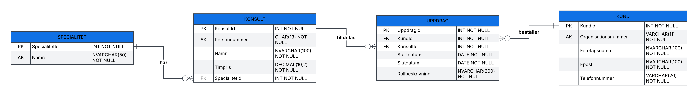

# FailSafe IT – relationsdatabas

Databas för kunder, konsulter och uppdrag i Microsoft SQL Server.
Kör `FailSafeIT.sql` i SSMS eller LocalDB. Skriptet droppar och återskapar databasen `FailSafeIT` varje gång, så det kan köras flera gånger med samma resultat (idempotent).

Skriptet innehåller:
- **DDL:** städar bort och skapar databasen samt alla tabeller med primärnycklar, främmande nycklar och villkor.
- **DML:** testdata med 4 kunder, 4 konsulter och 5 uppdrag.
- **Frågor A–E:** hämtning, JOIN, COUNT/GROUP BY, UPDATE och DELETE.

## ER-diagram

## Designval

**Kopplingstabell.** Jag använder tabellen Uppdrag som kopplingstabell mellan Kund och Konsult. En kund kan anlita flera konsulter, och en konsult kan arbeta åt flera kunder. Varje rad kopplar ihop en kund med en konsult och lagrar startdatum, slutdatum och rollbeskrivning för uppdraget.

**Samma specialitet för flera konsulter.** Det går bra. Specialiteten finns en gång i tabellen för specialiteter, och flera konsulter kan hänvisa till samma specialitets-ID genom en främmande nyckel. Då slipper vi upprepa specialitetens namn.

**Personnummer är inte primärnyckel.** Jag använder ett separat konsult-ID som primärnyckel eftersom det är unikt, stabilt och oberoende av personuppgifter. Då behöver personnumret inte spridas till andra tabeller som främmande nyckel. Personnumret har ändå en UNIQUE-begränsning eftersom det ska vara unikt.

## Normalisering (3NF)

**1NF:** Varje cell innehåller ett enda värde. Varje kund, konsult och uppdrag har en egen rad med ett unikt ID.

**2NF:** Alla uppgifter i en tabell hör till hela primärnyckeln. Kundens och konsultens uppgifter lagras i sina egna tabeller och kopplas ihop genom Uppdrag.

**3NF:** Uppgifterna beror bara på tabellens primärnyckel och inte på andra uppgifter. Specialiteter har en egen tabell, så att samma specialitet inte behöver skrivas flera gånger.

## DevSecOps-reflektion

**Sec – SQL Injection:** Jag använder parametriserade frågor (prepared statements) så att indata alltid behandlas som data och aldrig som SQL-kod. Dessutom får applikationens databasanvändare minsta möjliga rättigheter (t.ex. inte `DROP`), och indata valideras på serversidan.

**Ops – prestanda vid stor datamängd:** Jag skapar index på de kolumner som söks ofta, till exempel organisationsnummer. Där finns redan ett unikt index genom `UNIQUE`-villkoret, så SQL Server kan slå upp en kund med en index seek istället för att läsa hela tabellen. Främmande nycklar i `Uppdrag` har egna index för snabba JOIN-frågor.
